  

  

---

<h2>👨‍💻 Sobre mí</h2>

Estudiante de la <strong>Tecnicatura Superior en Análisis de Sistemas</strong>,
enfocado en el desarrollo de software, desarrollo web y resolución de problemas
mediante herramientas tecnológicas.

 

<table width="100%">
<tr>
<td width="45%" valign="top">
<h2>🎓 Formación</h2>
<b>🎓 Educación Académica</b>
  
<strong>Tecnicatura Superior en Análisis de Sistemas</strong>
 
🏫 IFTS N.º 21
 
📍 En curso (2.º año)
  
<b>📖 Formación Profesional</b>
  

<ul>
<li>SAP</li>
<li>Inglés</li>
</ul>
<strong>UTN</strong>
<ul>
<li>Microsoft Office (Excel, Word y PowerPoint)</li>
</ul>
</td>
<td width="55%" valign="top">
<h2>🛠️ Stack Tecnológico</h2>
<b>💻 Lenguajes y Frameworks</b>
  

  
<b>🗄️ Bases de Datos</b>
  

  
<b>🎨 Diseño y Gestión</b>
  

  
<b>🔧 Control de Versiones</b>
  

</td>
</tr>
<tr>
<td colspan="2" valign="top">
<h2>💼 Experiencia Práctica</h2>
<ul>
<li>💻 <strong>Proyectos Personales</strong></li>
<li>🎓 <strong>Desarrollo de Proyectos Académicos</strong></li>
<li>🤝 <strong>Participación en un Proyecto Colaborativo para una Aplicación Web con impacto social</strong></li>
</ul>
</td>
</tr>
</table>

---

<h2>📊 Mis números</h2>

---
